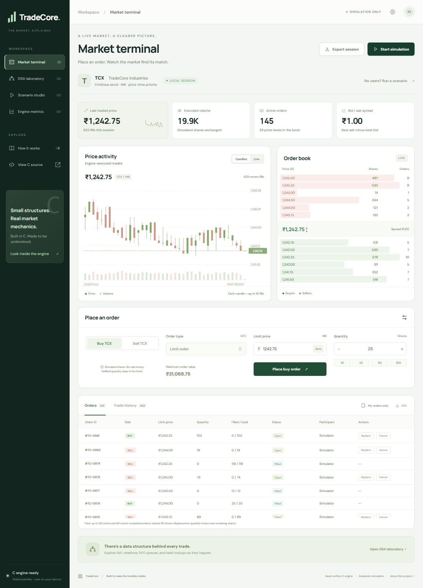

# TradeCore

**The market, explained.** A C-first stock exchange order-matching simulator with a professional browser dashboard and a native command-line interface.

> Academic simulation only. TCX, the shares, participants and trades are fictitious. No money, broker connection, settlement or investment advice.



## What works

- Buy and sell limit orders with price-time priority and maker-price execution.
- Partial fills, unmatched remainders, cancellation and atomic validation of cancel-and-replace.
- Hand-written **AVL price trees**, **FIFO doubly linked order lists**, **separate-chaining hash table** and **history arrays**.
- Live order book, price/volume chart, C-generated OHLCV candles, order activity and trade history.
- Interactive DSA laboratory with actual AVL nodes, balance factors, FIFO inspection, hash chains and engine trace events.
- Four classroom scenarios: FIFO priority, partial fills, AVL rotations and actual hash collisions.
- Seeded simulated traders, play/pause, adjustable activity speed and single-command scenario steps.
- Engine operation counters, measured browser/native timings and an invariant checker.
- Browser session persistence, replayable JSON session import/export and retained-trade CSV export.
- Native C CLI with session scripts, save/load, JSON export and benchmark commands.
- C local preview server, Windows/Unix build scripts, tests and Vercel deployment configuration.

## Why C and WebAssembly?

All matching, data structures, simulated order generation, snapshot serialization and candle aggregation are implemented in **`src/engine.c`**. The **same file** compiles to both a native executable and a small, self-contained `web/engine.wasm` module. No matching algorithm is duplicated in JavaScript.

HTML/CSS supply the browser interface; JavaScript connects browser controls to C, renders charts/structures, measures call time and handles browser file/storage APIs. This is the minimum browser layer; browsers do not display C source as a website. The CLI and local web server are C programs. Node is only used for an optional development/CI parity test, not to run the website.

This updates the earlier proposal's C + FastAPI + React plan to the requested C-first implementation. **There is no Python bridge, React dependency, SQLite database, WebSocket service or server-side matching process.** Vercel serves the static interface and compiled C engine. Each browser session owns a private simulated order book; users do not share a live exchange. Browser refresh replays locally saved commands.

## Windows quick start

Requirements: PowerShell and a C11 compiler. MSYS2 UCRT64 GCC is supported. A precompiled WebAssembly module is tracked, so the website needs no compiler or install step on Vercel.

```powershell
cd "$env:USERPROFILE\OneDrive\Desktop\DSA PBL"
.\build.ps1 -Test
.\build\tradecore.exe
```

To open the local dashboard:

```powershell
.\start.ps1
# Open http://127.0.0.1:4173
```

The local C server binds only to `127.0.0.1`. Stop it with Ctrl+C before rebuilding its executable on Windows. Run it from the project directory so it can locate `web/`.

## CLI example

```text
tradecore> sell 100.00 80
tradecore> sell 100.00 70
tradecore> sell 101.00 100
tradecore> sell 102.00 40
tradecore> buy 101.00 200
tradecore> buy 101.00 80
tradecore> book
tradecore> trades
tradecore> check
tradecore> save my-demo.tcx
```

Expected: four fills execute 250 shares. The final bid is 30 at Rs. 101.00 and the ask is 40 at Rs. 102.00. Both are simulated.

Or run the exact proposal example:

```powershell
.\build\tradecore.exe --script demos/partial-fill.tcx
.\build\tradecore.exe --script demos/partial-fill.tcx --json
```

Type `help` for all commands. `replace ID PRICE QUANTITY` means **new remaining quantity**, a new order ID and new arrival priority. Invalid replacements leave the old order intact.

## Build WebAssembly after editing C

Install the official [WASI SDK](https://github.com/WebAssembly/wasi-sdk/releases). Its Clang supports the freestanding WebAssembly target used here; no WASI host calls are imported.

```powershell
.\build.ps1 -Wasm -Test -WasiSdk 'C:\path\to\wasi-sdk'
# Or set WASI_SDK_PATH. This machine's cached SDK is also discovered automatically.
node tests/test-wasm.mjs
```

On Linux/macOS, use `make all test`, `make wasm` (Clang + wasm-ld required), then `node tests/test-wasm.mjs`. The native static server is `./build/tradecore-server 4173`. The command-line interface is `./build/tradecore`.

**Important:** Rebuild and commit `web/engine.wasm` whenever the C engine changes. CI compares native and WebAssembly snapshots to catch stale binaries. The compiler, SDK and local executables are not committed.

## Deploy to Vercel

Import `Aravch07/TradeCore` as a Vercel project. `vercel.json` selects `web/` as the output directory, with no dependency installation or build command. The compiled module is served as `application/wasm`.

Or, from the project folder with an authenticated Vercel CLI:

```powershell
vercel --prod
```

Deployment does not create a shared server or database. Local browser sessions remain independent. WebAssembly is supported by modern browsers; if the engine fails to load, the page reports that error instead of using a JavaScript substitute.

## Repository guide

```text
include/tradecore.h       Engine API and data structures
src/engine.c             C matching, AVL/FIFO/hash, simulation, trace, candles, JSON
src/cli.c                Native C command line, scripts and session files
src/server.c             C loopback static preview server
web/                     Dashboard and compiled WebAssembly module
tests/test_engine.c      C assertions and randomized reference-matcher comparison
tests/test-wasm.mjs      Exact native/WASM snapshot parity and candle checks
demos/                   Replayable classroom scripts
docs/ARCHITECTURE.md      Algorithms, ownership, costs and boundaries
docs/DEMO.md              Faculty demonstration walkthrough
docs/TESTING.md           Verification and reproducible measurement instructions
build.ps1 / Makefile     Native and WebAssembly build commands
vercel.json              Static hosting configuration
```

## Capacity and visibility

- Up to **8,192 active resting orders** and **2,048 price levels** across both sides. Fixed pools recycle completed/cancelled nodes. A conservative preflight may reject an incoming order when no free slot exists, even if it would immediately match.
- Valid price: Rs. 0.01 to Rs. 1,000,000.00, in integer paise. Quantity: 1 to 1,000,000 whole shares. Level totals and traded volume use 64-bit integers.
- The order book snapshot retains the best 24 levels per side; the terminal displays the best six. Trees show up to 50 nodes per side. Queue inspection shows up to 200 orders. These are display windows, not engine capacities.
- Snapshots contain the newest 120 active orders and 60 archived outcomes; the activity table shows the newest 80. Traces retain 128 events; trade history retains 2,048 fills. CSV exports that retained fill window.
- Browser sessions retain at most 10,000 command calls, with an import replay-work limit of 100,000. CLI journals retain up to 32,768 commands; files are command logs, not durable transactional storage. Export before replacing a session.
- No accounts, cash/inventory ledger, ownership permissions, trading fees, order expiry, market/stop/iceberg orders, real feeds, crash-safe storage or multi-user synchronization.
- Timing is measured on the current device. Engine-only call time, simulator generation, tracing, serialization and UI overhead are distinguished; no fixed performance claims are made.

## Documentation

[Architecture](docs/ARCHITECTURE.md) · [Teacher demo](docs/DEMO.md) · [Testing](docs/TESTING.md)
