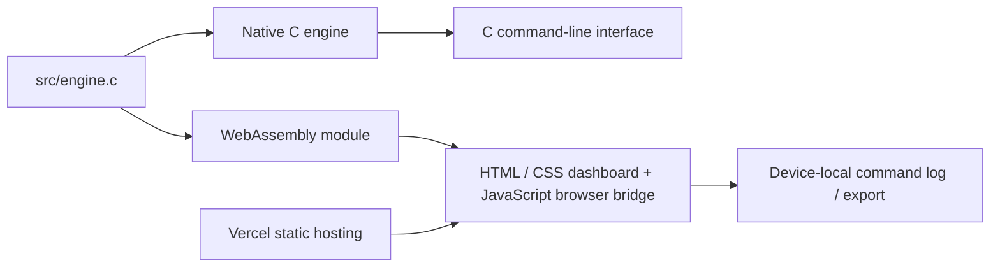

# Architecture and algorithms

## One C engine, two targets

The browser does not call a server matching API. Commands directly invoke exported C functions on the device. WebAssembly imports no host functions and has bounded linear memory. C snapshot output is JSON; imported files are validated as a versioned command log, then replayed through the same C operations. No snapshot JSON is trusted as engine state.

## Ownership and data structures

- Two AVL roots, one per side. Price-level nodes contain a price key, child links, height, FIFO head/tail, order count and 64-bit remaining-quantity total.
- Cached maximum bid and minimum ask supply constant-time best-price reads. Structural changes refresh those extrema.
- Each active order has previous/next links within its price-level FIFO, a reference to its owning price node and a next link in its hash collision chain. Additional previous/next links enumerate active orders chronologically for snapshot views.
- The 2,048-bucket hash table uses `(unsigned(id) * 2654435761) & 2047` with separate chaining. It is intentionally bounded, not dynamically resized. At maximum capacity its load factor is 4.
- Fixed arrays hold reusable order/price node pools, free-index stacks, history and traces. Indices are stable references; `-1` is the null link. Freed nodes return to their pools.
- During AVL deletion, the successor node is structurally transplanted, rather than copying its price into a different node. Existing order-to-level references remain valid.
- History is a 2,048-fill ring buffer. OHLCV candles group up to 16 retained fills in chronological order in C. The first/last candle can change when the history window advances; these are fill-count bars, not wall-clock candles.

## Matching and modification

1. Validate side, price, quantity and available pool capacity. An invalid command must not modify an existing order.
2. Assign a new unique order ID and command sequence.
3. Read the best opposite level. If the incoming limit crosses, execute against its FIFO head at the resting maker price.
4. Fill `min(incoming_remaining, maker_remaining)`. Update both quantities and the level total.
5. Remove filled makers from the linked list and hash table; archive their outcomes and recycle nodes. Delete empty AVL levels.
6. Continue until the incoming quantity is exhausted or the next price does not cross. Append any remainder to its own level tail and index it by ID.

Cancellation removes only remaining quantity. Replace first validates the new limit and **new remaining quantity**, then removes the original and submits a new order with a fresh ID and sequence. Every modification loses queue priority, including a quantity decrease. This is a documented simplification. Self-matching is allowed because there is no account ledger or ownership model.

## Cost model

Let N be active orders, P active price levels, F fills generated by one incoming order and D emptied levels.

| Operation | Cost and qualification |
|---|---|
| AVL level lookup/insert/delete | O(log P) worst case |
| Best-price read | O(1), using maintained cached extrema |
| FIFO append/unlink known order | O(1), excluding level lookup/removal |
| Hash lookup | Expected O(1) under a well-distributed hash and bounded load; O(N) worst case |
| Cancel | Expected O(1); O(log P) extra if its level becomes empty |
| Match with residual insertion | Expected O(F + (D + 1) log(P + 1)); worst-case hashing can increase this |
| History append | O(1), fixed ring buffer |
| Invariant check / snapshot | Linear scans/window traversals; diagnostic and presentation work, outside the matching cost claim |

Physical storage is preallocated by the configured capacities, not allocated in proportion to current occupancy. Logical occupied storage is O(N + P + retained history). Snapshot JSON and validation buffers are included in the reserved-buffer counter. The WASM stack and overall browser memory are not included.

## Determinism and observability

Engine sequences, not client clocks, break price ties. A seeded xorshift32 generator supplies bot commands. Equal initial mode plus an identical command log yields the same tree/order IDs, fills and event sequence in native and WASM targets. Layout and charts render numeric snapshots; JavaScript never decides a match.

Trace events identify accepted orders, level comparisons, left/right rotations, FIFO append, fills, new/empty levels, hash insertion and cancellations. The visualizer displays command-boundary state. Selecting an older event highlights its price in the **current** tree; it does not rewind pointers to an intermediate mutation.

## Persistence and limits

Browser localStorage stores a bounded command log; exports include that log and a human-inspectable bounded snapshot. Refresh/import reconstructs the engine by replay, not by deserializing pointers. Browser persistence is device-local, capacity-limited and not crash-safe financial storage. The CLI saves plain-text command scripts. Neither frontend claims shared multi-user state, database transactions, WebSocket delivery or production security.

The C server is a local preview utility, not an internet trading backend. It serves an explicit file allowlist, binds to loopback and has no arbitrary file-access endpoint.
